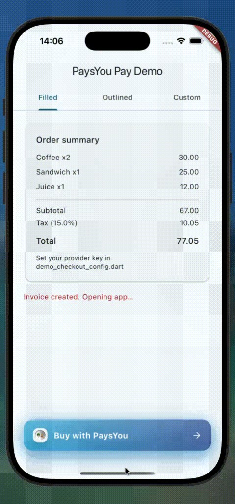

# paysyou_pay

[](https://pub.dev/packages/paysyou_pay)
[](LICENSE)
[](https://flutter.dev)

<!-- Uncomment and replace YOUR_ORG when GitHub repo and CI are ready:
[](https://github.com/YOUR_ORG/paysyou_pay/actions/workflows/ci.yml)
[](https://codecov.io/gh/YOUR_ORG/paysyou_pay)
-->

Flutter package for merchant apps that need to prepare a PaysYou payment, receive hosted and deep-link redirects, and reuse branded payment buttons.

## Preview



*Example app: order summary, branded payment buttons, and payment preparation feedback.*

`paysyou_pay` encapsulates the PaysYou payment-preparation endpoint and exposes:

- a typed Dart API for preparing payments
- the full backend response for custom business logic
- reusable premium payment buttons
- helper methods for launching the PaysYou app with deep link

## Table of Contents

- [Preview](#preview)
- [Features](#features)
- [Supported Platforms](#supported-platforms)
- [Requirements](#requirements)
- [Installation](#installation)
- [Setup](#setup)
- [Usage](#usage)
- [Response Payload](#response-payload)
- [Redirect Handling](#redirect-handling)
- [Built-In Payment Button](#built-in-payment-button)
- [Custom Button Builder](#custom-button-builder)
- [Example App](#example-app)
- [Testing](#testing)
- [Architecture](#architecture)
- [Public API](#public-api)
- [Contributing](#contributing)
- [Badges](#badges)
- [License](#license)

## Features

- Prepare a payment with a typed Dart API
- Return the full backend payload for custom business flows
- Use `redirectUrl` for hosted checkout in a browser or web view
- Use `redirectDeepLink` to open the PaysYou app
- Use premium built-in `PaysYouPayButton` widgets
- Customize button UI with `builder`, `loadingBuilder`, and `borderRadius`
- Reuse the branded `PaysYouPayLogo` widget in custom UIs
- Keep the PaysYou endpoint encapsulated inside the package

## Supported Platforms

This package is a Flutter package and can be added to Flutter apps on:

- Android
- iOS
- Web
- macOS
- Windows
- Linux

Notes:

- Deep-link app-launch flows are primarily intended for mobile app experiences.
- Hosted payment flows using `redirectUrl` are suitable when you want to continue in a browser or web view.
- Final behavior depends on the host app platform and the target device’s deep-link support.

## Requirements

- Flutter SDK `>=1.17.0`
- Dart SDK `^3.11.0`

## Installation

Add the package to your app:

```yaml
dependencies:
  paysyou_pay: ^0.1.0
```

For local development:

```yaml
dependencies:
  paysyou_pay:
    path: ../paysyou_pay
```

Then install dependencies:

```bash
flutter pub get
```

## Setup

Create a `PaysYouPay` instance:

```dart
import 'package:paysyou_pay/paysyou_pay.dart';

final paysYouPay = PaysYouPay();
```

Prepare the request data:

```dart
final invoice = PaysYouInvoice(
  amount: '99.50',
  secretKey: 'your_provider_secret',
  callbackUrl: 'https://your-app.com/payment/callback',
  invoiceDate: DateTime.now(),
  coupon: 'OPTIONAL_COUPON',
);
```

## Usage

### 1. Prepare payment only

Use this flow when your app wants the response and will decide what to do next:

```dart
final result = await paysYouPay.pay(invoice);
```

### 2. Prepare payment and launch the PaysYou app manually

```dart
final result = await paysYouPay.pay(invoice);
await paysYouPay.launchPaymentApp(result);
```

### 3. One-call prepare-and-launch flow

```dart
await paysYouPay.payAndLaunch(invoice);
```

### 4. Use the low-level creation method

```dart
final result = await paysYouPay.createInvoice(invoice);
```

## Response Payload

`pay()` and `createInvoice()` return a `CreateInvoiceResult`.

Example backend response:

```json
{
  "status": 200,
  "message": "Payment prepared successfully.",
  "the_total": 0,
  "data": {
    "invoice_id": 150,
    "redirect_url": "https://pays-you.com/bill/150",
    "redirect_deep_link": "https://pays-you.com/deeplink/bill?id=150"
  },
  "errors": {}
}
```

Access the values like this:

```dart
print(result.status);
print(result.message);
print(result.theTotal);
print(result.invoiceId);
print(result.redirectUrl);
print(result.redirectDeepLink);
print(result.errors);
print(result.toJson());
```

## Redirect Handling

Use the returned URLs depending on your checkout experience:

- `result.redirectUrl`: open the hosted payment page in a browser or web view
- `result.redirectDeepLink`: open the PaysYou app using deep link

Example custom business flow:

```dart
final result = await paysYouPay.pay(invoice);

final json = result.toJson();
final redirectUrl = result.redirectUrl;
final redirectDeepLink = result.redirectDeepLink;

// Your app decides what to do next.
```

## Built-In Payment Button

Use the built-in branded button:

```dart
PaysYouPayButton(
  paysYouPay: paysYouPay,
  invoice: invoice,
  style: PaysYouPayButtonStyle.filled,
  borderRadius: 18,
  onSuccess: () {
    // The button prepares payment and opens the app deep link.
  },
  onError: (error) {
    debugPrint(error.message);
  },
)
```

Use the outlined style:

```dart
PaysYouPayButton(
  paysYouPay: paysYouPay,
  invoice: invoice,
  style: PaysYouPayButtonStyle.outlined,
)
```

The built-in button supports:

- premium gradient styling
- dark theme support
- custom border radius
- branded logo
- loading state customization

## Custom Button Builder

If you want to use your own UI:

```dart
PaysYouPayButton(
  paysYouPay: paysYouPay,
  invoice: invoice,
  builder: (context, onPressed, isLoading) {
    return ElevatedButton(
      onPressed: onPressed,
      child: Text(isLoading ? 'Processing...' : 'Buy with PaysYou'),
    );
  },
  loadingBuilder: (context) => const CircularProgressIndicator(),
)
```

You can also use the exported package logo:

```dart
const PaysYouPayLogo(size: 30)
```

## Example App

An example app is included in `example/` and demonstrates:

- filled branded button
- outlined branded button
- custom button builder
- response-driven business flow with returned JSON
- hosted URL and deep-link usage guidance

Run it with:

```bash
cd example
flutter pub get
flutter run
```

Set your provider key in `example/lib/demo_checkout_config.dart`.

## Testing

Run the package tests:

```bash
flutter test
```

Run static analysis:

```bash
dart analyze lib test example/lib
```

Run the example app tests:

```bash
cd example
flutter test
```

## Architecture

| Layer | Responsibility |
|-------|----------------|
| `PaymentService` / `PaysYouPay` | Prepare payments and optionally launch the app |
| `InvoiceApi` / `PaysYouPayApiClient` | HTTP communication |
| `InvoiceValidator` | Input validation |
| `CreateInvoicePayloadMapper` | Request payload mapping |
| `CreateInvoiceResponseParser` | Response parsing |
| `DeepLinkLauncher` | Deep-link app launching |

The PaysYou endpoint is encapsulated inside the package and is not exposed as a public configurable URL.

## Public API

Main exports:

- `PaysYouPay`
- `PaysYouInvoice`
- `CreateInvoiceResult`
- `PaysYouPayButton`
- `PaysYouPayButtonStyle`
- `PaysYouPayLogo`
- `PaysYouPayException`
 

## License

This package is released under the MIT License. See `LICENSE`.
